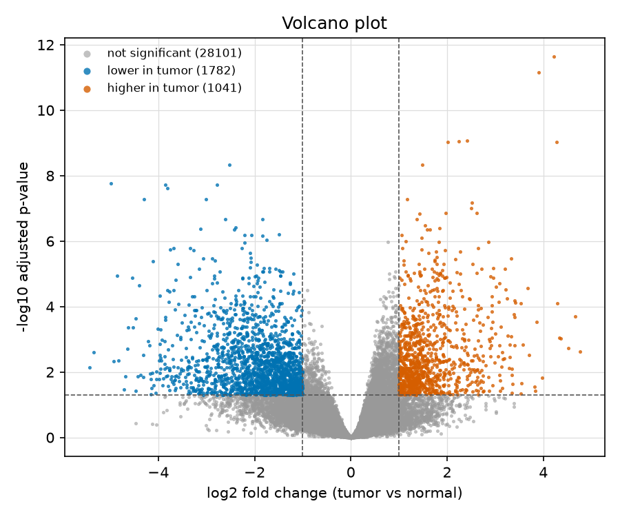

# Tumor vs normal gene expression in breast cancer: a paired RNA-seq analysis

*Dry-lab analysis of public data (GEO GSE133998). Code and rerun instructions: [README.md](README.md).*

## Question
Which genes and biological pathways differ between breast tumor tissue and the normal tissue next to it?

## Data
GEO series GSE133998: 6 breast cancer patients, each with one tumor sample and one adjacent-normal sample (12 samples). The file contains raw read counts for 61,155 gene rows. After removing 2 empty rows and merging 2 duplicate rows, 61,151 genes remained. Libraries had about 17 to 26 million reads each, with no outliers. Details: [data/DATASET.md](data/DATASET.md).

## Methods
1. **Filtering.** Genes needed at least 10 reads in total and at least 1 read in 3 or more samples. This left 38,362 genes.
2. **Quality control.** PCA and a sample-correlation heatmap (`results/qc_pca.png`, `results/qc_correlation.png`).
3. **Differential expression.** PyDESeq2 with the design `~ patient + condition`, which compares each tumor with its own patient's normal tissue. Positive log2 fold change means higher in tumor. A gene is called significant at adjusted p < 0.05 and |log2 fold change| > 1.
4. **Pathways.** Over-representation test on the genes higher in tumor and the genes lower in tumor separately, using the MSigDB Hallmark 2020 and KEGG 2026 gene sets (fetched from Enrichr). The background is the 38,362 genes that were tested, so non-coding and unexpressed genes do not distort the result.
5. **Markers.** Direction of change compared with 11 genes taken from three published studies (`data/known_markers.csv`). These are a selection of genes for which a paper states a clear tumor-vs-normal direction, not every gene those papers mention. I chose them before running the comparison.

Random seed 42. The whole analysis reruns with `python run_all.py`.

## Results

**Quality control.** In the PCA, tumor and normal samples separate mostly along PC1 (silhouette score 0.326, where 0 would mean no separation). The separation is partial. Patient H40's tumor and normal samples sit close together. In the correlation heatmap, H36-adj does not group with the other normal samples, and H42-adj groups with the tumor samples. I kept all samples, and the paired design accounts for patient differences.

**Differential expression.** 38,362 genes were tested. 2,823 were significant: **1,041 higher and 1,782 lower in tumor** ([volcano plot](results/volcano.png), [MA plot](results/ma_plot.png)). The most significant genes higher in tumor include COMP, LRRC15, MATN3, GAPT and EPYC. The most significant lower genes include VLDLR-AS1, TAT, EGFR-AS1, AC005089.1 and HIF3A. The top 30 genes are shown in the [heatmap](results/top_genes_heatmap.png).

**Pathways, genes higher in tumor.** 30 of 49 Hallmark sets and 89 of 278 KEGG sets were enriched (adjusted p < 0.05). The strongest Hallmark sets are Allograft Rejection, Interferon Gamma Response, G2-M Checkpoint, Epithelial Mesenchymal Transition and Interferon Alpha Response. The strongest KEGG sets are Cytokine-Cytokine Receptor Interaction, Cell Adhesion Molecule Interaction and Primary Immunodeficiency.

**Pathways, genes lower in tumor.** 1 of 43 Hallmark sets (Myogenesis) and 9 of 274 KEGG sets were enriched. The KEGG sets are Neuroactive Ligand-Receptor Interaction, Cytoskeleton in Muscle Cells, Regulation of Lipolysis in Adipocytes, Tyrosine Metabolism, Neuroactive Ligand Signaling, cAMP Signaling Pathway, Nitrogen Metabolism, Cornified Envelope Formation and Proximal Tubule Bicarbonate Reclamation. Hallmark Adipogenesis was close to the cutoff but not significant (adjusted p = 0.058).

**Comparison with published markers.** Of 11 markers, 10 could be tested. All 10 changed in the published direction (0 disagreed). 6 of the 10 were also significant here: COL10A1, TUBB3, MMP1, COL11A1, S100P and LEP. The other four (ADIPOQ, DLK1, OXTR, PIGR) moved in the expected direction but were not significant (adjusted p between 0.068 and 0.334), so I do not count them as confirmed. MMP11 could not be tested: it has 2 reads in total in this file and was removed by the filter. Published work reports it strongly higher in tumors, and I do not know why it is nearly absent here.

ESR1 and ERBB2 are not in the marker list because I found no cited tumor-vs-normal direction for them. For information, ESR1 was slightly higher in tumor (log2 fold change 0.62, adjusted p = 0.43) and ERBB2 was higher (0.88, adjusted p = 0.23). Neither is significant.

## Interpretation
The strongest signals are a rise in cell-cycle genes (G2-M Checkpoint), tissue-remodeling genes (Epithelial Mesenchymal Transition, collagens such as COL10A1 and COL11A1) and immune genes (interferon response, cytokine signaling). This is bulk tissue, so the immune result may partly mean more immune cells in tumor tissue, not only changes inside tumor cells. In the same way, lower lipolysis and fat-cell genes (Regulation of Lipolysis in Adipocytes, LEP) may mean less fat tissue in the tumor samples.

## Limitations
- **Small sample.** 6 patients means low power. Results are exploratory and should be checked in a larger dataset.
- **Control tissue.** "Normal" is tissue next to the tumor. It can carry some tumor-related changes.
- **Samples that do not separate cleanly.** H40, H36-adj and H42-adj behave unexpectedly (see Quality control). The cause is unknown; low tumor purity or contamination are possible.
- **Low-expression genes.** The filter is loose. About a quarter of the significant genes (698 of 2,823) have a mean normalized count below 18, so their fold changes are noisy. I did not apply fold-change shrinkage.
- **Genes without an adjusted p-value.** 7,438 of the 38,362 genes have no adjusted p-value (DESeq2 filters low-count or outlier genes). They do not appear in the volcano and MA plots, which is why the plot legends add up to fewer than 38,362 genes.
- **Gene sets.** Some top "down" genes are non-coding (for example VLDLR-AS1) and cannot belong to a pathway.
- **Not tested.** No survival analysis, no tumor subtypes, no validation in a second dataset.

## Where each number comes from
| Number | File |
|---|---|
| Samples, reads per library, outliers | `results/qc_library_sizes.csv` |
| Silhouette 0.326, genes kept (38,362) | `results/qc_summary.csv` |
| 38,362 tested, 2,823 significant, 1,041 up, 1,782 down, ESR1/ERBB2, 698 low-expression, 7,438 without padj | `results/dge_all.csv`, `results/dge_significant.csv` |
| Enriched sets (30 and 89 up; 1 and 9 down) | `results/enrichment_*.csv` |
| Marker agreement (10 of 10 tested, 6 significant) | `results/marker_comparison.csv` |

## Sources of the marker directions
- Fu J, et al. 2015. Gene expression profiling leads to discovery of correlation of matrix metalloproteinase 11 and heparanase 2 in breast cancer progression. BMC Cancer 15:473. doi:10.1186/s12885-015-1410-y
- Makoukji J, et al. 2016. Gene expression profiling of breast cancer in Lebanese women. Scientific Reports 6:36639. doi:10.1038/srep36639
- Zhang M, et al. 2020. Bioinformatics analysis of prognostic significance of COL10A1 in breast cancer. Bioscience Reports 40(2):BSR20193286 (PMC7029149), cited for COL10A1.

Data: Dong X, Wei L, et al., GEO GSE133998 (contributors as listed on the GEO page).
